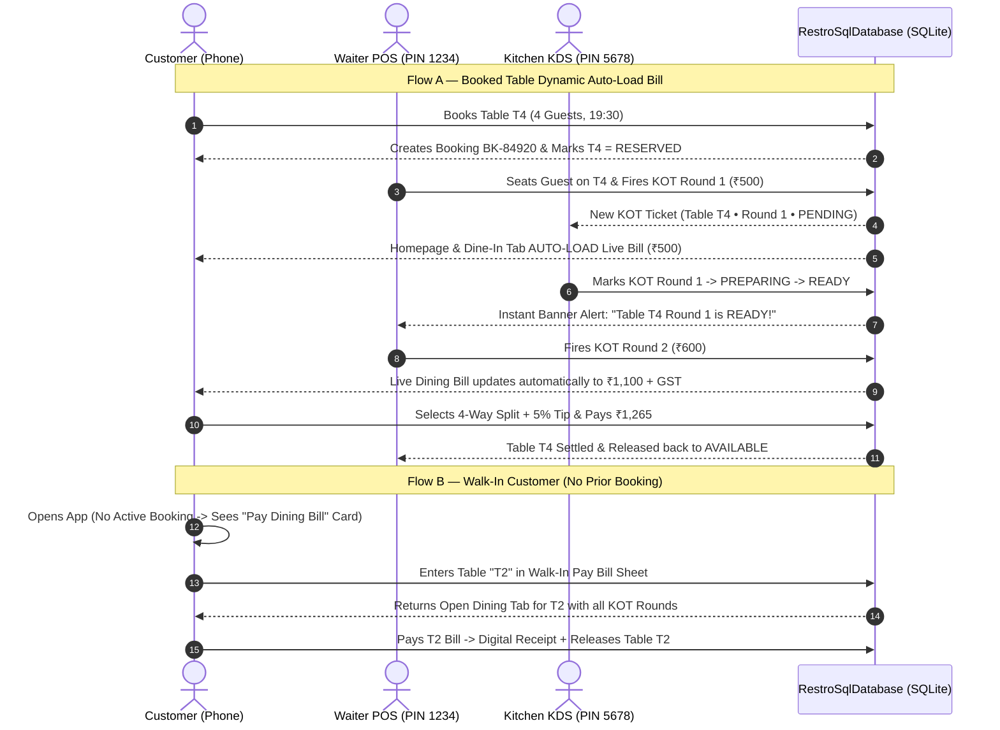

# Restro Super-App — Complete Visual Blueprint, Feature Architecture, Database Spec & Audit Report

> [!IMPORTANT]
> **Executive Summary**: Around **80% of the UI screens and SQLite schema methods exist in the codebase**, but **only ~54–58% of the end-to-end user experience works properly on a real physical phone (`moto g45 5G`)** due to:
> 1. **Cart Wipe Bug**: `DeliveryApi.kt` line 153 (`cleanPath == "/cart" -> Cart()`) overwrites `PUT /cart` with an empty `Cart()`, resetting dishes and coupons.
> 2. **Emulator IP Freeze (`http://10.0.2.2:8080`)**: Hardcoded in `build.gradle.kts` and `ApiClient.kt`, causing **2–3 second freezes** on physical hardware whenever unhandled endpoints (`/auth/login`, `/profile`, `/quote`, `/addresses`, `/favorites`, `/reviews`, Staff POS/KDS/Analytics) are called.
> 3. **Missing Hardware GPS & Fake Map Grids**: No `ACCESS_FINE_LOCATION` permission in `AndroidManifest.xml`, no hardware `LocationManager` / `Geocoder`, and `MapComponents.kt` draws 9 static lines on a `Canvas` instead of real interactive OpenStreetMap street tiles and live 10s rider tracking.
> 4. **Split Databases**: Customer screens use `RestroSqlDatabase` (10 tables `T1`–`T10`, 24 dishes), while the Staff Portal (`MainActivity.kt`) calls `ApiClient.kt` and falls back to 4 dummy tables (`T1`–`T4`), 5 dummy dishes, and `₹0.00` analytics.

---

## 1. Visual Design System — How the App Should Look & Feel

### 1.1 Color Palette & Surface Hierarchy
The app follows a **Warm Culinary Dark-First / High-Contrast Modern Aesthetic** (inspired by Swiggy/Zomato + Toast POS):

| Token | Hex Code | Usage in App |
| :--- | :--- | :--- |
| **Primary Brand (`Saffron Flame`)** | `#FF5722` / `#E23744` | Primary CTAs, Active Bottom Tab, Add `+` Buttons, Live Rider Pin, Active KOT Badges |
| **Secondary Accent (`Amber Gold`)** | `#FFB300` | Star Ratings, Gold Offers, Reserved Table Badge (`RESERVED`), Kitchen `PREPARING` status |
| **Success (`Emerald Herb`)** | `#1B8E3E` / `#2E7D32` | Pure Veg indicator, Available Table (`AVAILABLE`), Order Delivered, KDS `READY` badge, Savings banners |
| **Warning / Occupied (`Coral Burgundy`)** | `#D32F2F` | Non-Veg indicator, Occupied Table (`OCCUPIED`), Out-of-Delivery-Range Lock (`> 6.5 km`), SLA Breach |
| **Info / GPS (`Electric Cobalt`)** | `#1976D2` | Live Hardware GPS pulsing dot, `6.5 km` radius circle, Split Bill badge, Rider route polyline |
| **App Background (Customer)** | `#F8F9FA` (Light) / `#121212` (Dark) | Clean card separation with subtle elevation (`2dp`–`6dp` rounded `16dp` corners) |
| **Staff Portal Surface (POS / KDS)** | `#0F172A` -> `#1E293B` | High-contrast slate dark mode optimized for fast reading in restaurant lighting |

### 1.2 Typography & Component Styling
- **Headings**: Bold Geometric Sans (`20sp`–`24sp`, `FontWeight.ExtraBold`) for screen titles, restaurant names, and bill totals.
- **Price & Currency (`₹`)**: Monospace/Tabular numerals (`FontWeight.Bold`) so bill subtotals, GST, tips, and split shares align vertically.
- **Cards**: `16.dp` rounded corners, subtle `1.dp` border (`#E2E8F0` light / `#2D3748` dark), high-resolution dish/restaurant imagery with gradient scrim overlays for badges.
- **Bottom Navigation Bar (Customer Mode — 5 Tabs)**:
  1. `Delivery` (Food discovery, GPS header, restaurants, map toggle)
  2. `Dine-In` (10-table floor plan, Book Table, My Active Table Bill / Walk-In Pay Bill)
  3. `Orders` (Active live-tracked delivery orders, past orders, 1-tap reorder)
  4. `Bookings` (Upcoming & past table reservations with QR check-in pass)
  5. `Profile` (Saved GPS addresses, payment methods, favorites, Staff Portal switch)

---

## 2. Screen-by-Screen Visual Wireframes — How Every Screen Should Look

### Screen 1: Universal Auth Gatekeeper & Role-Aware Login (`AuthScreen`)
**When Shown**: Immediately on cold launch if no valid encrypted session exists in `SessionGuardian`. Zero unauthenticated access is permitted.

```text
+-------------------------------------------------------------------+
|  [Restro Logo]                                  [Staff PIN Pad]   |
|  Welcome to Restro Super-App                                      |
|   Fine Dining, Instant Delivery & Live POS                         |
|                                                                   |
|  SELECT LOGIN ROLE                                                |
|  (•) Customer   ( ) Waiter POS   ( ) Chef KDS   ( ) Admin         |
|                                                                   |
|  +-----------------------------+-------------------------------+  |
|  |      6-Digit OTP Login      |       Password Login          |  |
|  +-----------------------------+-------------------------------+  |
|                                                                   |
|  Phone Number or Email                                            |
|  [ +91 98765 43210                                           ]    |
|                                                                   |
|  [  Send 6-Digit Verification OTP                            ]    |
|                                                                   |
|  +-------------------------------------------------------------+  |
|  | DEMO OTP PREVIEW (SQLite): 4 8 2 9 1 0   [Tap to Autofill]  |  |
|  +-------------------------------------------------------------+  |
|                                                                   |
|  Enter 6-Digit OTP                                                |
|  [ 4 ]  [ 8 ]  [ 2 ]  [ 9 ]  [ 1 ]  [ 0 ]     Expires in 04:42    |
|                                                                   |
|  [          VERIFY & CONTINUE  -->                           ]    |
+-------------------------------------------------------------------+
```
- **Expected Behavior**:
  - If user logs in as `CUSTOMER` -> lands on **Customer Delivery Homepage**.
  - If user logs in as `WAITER`, `CHEF_KDS`, or `ADMIN` (or unlocks the top-right **4-Digit Staff PIN Pad** `1234` / `5678` / `9999`) -> routes **directly** into the **Staff Operations Portal** for that role.

---

### Screen 2: Customer Homepage — Live GPS Header & Conditional Dining Bill (`DiscoveryScreens`)
**When Shown**: Default landing screen for authenticated Customers.

```text
+-------------------------------------------------------------------+
|  [📍 LIVE GPS] Indiranagar, 100 Ft Rd  ▼    [Staff PIN] [Profile] |
|  Lat: 12.9784, Lng: 77.6408 • Within 6.5 km Delivery Zone         |
+-------------------------------------------------------------------+
|  🔍 Search dishes, cuisines, or restaurants...      [Veg Only ○]  |
+-------------------------------------------------------------------+
|  DYNAMIC DINE-IN BANNER (Automatically switches based on SQLite): |
|                                                                   |
|  ┌─ CASE A: IF USER HAS AN ACTIVE BOOKED/SEATED TABLE (e.g. T4) ─┐|
|  | 🍽️ LIVE TABLE BILL • TABLE T4 (Window Lounge • 4 Guests)      ||
|  | Status: SEATED • 2 KOT Rounds Served • Running Total: ₹1,280  ||
|  | [ View Live KOT Items ]             [ Split & Pay Bill ₹1,280 ]||
|  └───────────────────────────────────────────────────────────────┘|
|  ┌─ CASE B: IF NO TABLE IS BOOKED (WALK-IN CUSTOMER MODE) ───────┐|
|  | 🪑 At the Restaurant?                                         ||
|  | [ 📅 Book a Table (T1–T10) ]    [ 💳 Pay Walk-In Dining Bill ]||
|  └───────────────────────────────────────────────────────────────┘|
+-------------------------------------------------------------------+
|  ⚡ FREQUENTLY ORDERED BY YOU                                     |
|  +------------------+  +------------------+  +------------------+ |
|  | Truffle Burger   |  | Butter Chicken   |  | Classic Tiramisu | |
|  | ₹349  [+ Reorder]|  | ₹420  [+ Reorder]|  | ₹260  [+ Reorder]| |
|  +------------------+  +------------------+  +------------------+ |
+-------------------------------------------------------------------+
|  NEARBY RESTAURANTS (Sorted by Haversine GPS Distance)            |
|  [ 📋 List View ]                           [ 🗺️ Live Map View ]  |
|                                                                   |
|  +-------------------------------------------------------------+  |
|  | [Hero Image: The Spice Route]          ⭐ 4.7   22 mins     |  |
|  | The Spice Route • North Indian, Mughlai                     |  |
|  | 📍 1.4 km away • ₹40 Delivery Fee • "WELCOME50" Available   |  |
|  | [ View Delivery Menu ]              [ Book Dining Table ]   |  |
|  +-------------------------------------------------------------+  |
|  +-------------------------------------------------------------+  |
|  | [Hero Image: Whitefield Smokehouse]    🔒 OUT OF RANGE      |  |
|  | Whitefield Smokehouse • BBQ, Steaks                         |  |
|  | 📍 9.8 km away (Exceeds 6.5 km max radius from your GPS)    |  |
|  +-------------------------------------------------------------+  |
+-------------------------------------------------------------------+
|  [🏠 Delivery]  [🪑 Dine-In]  [📦 Orders]  [📅 Bookings] [👤 Me] |
+-------------------------------------------------------------------+
```

---

### Screen 3: Interactive Live Street Map Discovery & GPS Picker (`MapComponents` + `LandmarkPickerSheet`)
**When Shown**: When user taps the GPS Header or switches to **Live Map View** on the Homepage.

```text
+-------------------------------------------------------------------+
|  🗺️ LIVE INTERACTIVE STREET MAP (OpenStreetMap Tiles)             |
|  +-------------------------------------------------------------+  |
|  |   [Street Grid / Real Roads: 100 Feet Rd, CMH Rd, MG Rd]    |  |
|  |                                                             |  |
|  |         ╭───────────────────────────────────╮               |  |
|  |        ╱   6.5 km Delivery Radius Boundary   ╲              |  |
|  |       │                                       │             |  |
|  |       │    [📍 ₹350 • 4.7★]                   │             |  |
|  |       │     The Spice Route                   │             |  |
|  |       │                                       │             |  |
|  |       │              (🔵) <-- Your Live Hardware GPS        |  |
|  |       │                   (12.9784, 77.6408)  │             |  |
|  |       │                                       │             |  |
|  |        ╲         [📍 ₹280 • 4.5★]            ╱              |  |
|  |         ╰─────────Napoli Pizzeria───────────╯               |  |
|  |                                                             |  |
|  |                                    [🔒 9.8 km Out of Range] |  |
|  |                                                      [+] [-]|  |
|  |                                              [🎯 Recenter]  |  |
|  +-------------------------------------------------------------+  |
|  | SELECTED PIN: The Spice Route (1.4 km • 22 mins)  [Open ->] |  |
|  +-------------------------------------------------------------+  |
+-------------------------------------------------------------------+
```
**GPS Location Bottom Sheet (`LandmarkPickerSheet`)**:
- **[ 🎯 Use My Current Hardware GPS Location ]**: Requests `ACCESS_FINE_LOCATION`, reads real latitude/longitude from Android `LocationManager`, reverse-geocodes street address via `Geocoder`, updates both the Homepage header **and** Checkout delivery coordinates.
- **Quick Preset Landmarks (for testing different delivery zones)**:
  - *Indiranagar (`12.9784, 77.6408`)*
  - *Koramangala (`12.9352, 77.6245`)*
  - *Lavelle Road (`12.9716, 77.5946`)*
  - *Bellandur (`12.9260, 77.6762`)*
  - *Whitefield (`12.9698, 77.7500` — triggers Out-of-Range test)*

---

### Screen 4: Restaurant Menu, Dish Customizer & Sticky Cart (`RestaurantDetailScreen`)
**When Shown**: Tapping any in-range restaurant card.

```text
+-------------------------------------------------------------------+
|  < Back   The Spice Route                          [❤️] [Share]   |
|  ⭐ 4.7 (1.2k+ reviews) • 1.4 km • 22 mins • ₹40 Delivery         |
|  [ 🪑 Book a Dining Table Here ]     [ 🏷️ 50% OFF: WELCOME50 ]    |
+-------------------------------------------------------------------+
|  [All (24)]  [🔥 Bestsellers]  [Starters]  [Mains]  [Breads]      |
|  Filter: [🟢 Pure Veg]  [🔺 Non-Veg]  [🔍 Search in Menu...]      |
+-------------------------------------------------------------------+
|  🟢 Smoked Dal Makhani                             [Dish Photo]   |
|     ₹320 • Slow-cooked black lentils over charcoal  [- 2 +]       |
|     Customizable • 480 kcal                                       |
|  ---------------------------------------------------------------  |
|  🔺 Old Delhi Butter Chicken                       [Dish Photo]   |
|     ₹420 • Tandoori chicken tikka in makhani gravy  [ + ADD ]     |
+-------------------------------------------------------------------+
|  ╔═════════════════════════════════════════════════════════════╗  |
|  ║ 🛒 2 Items | ₹640                     [ View Cart & Pay -> ]║  |
|  ╚═════════════════════════════════════════════════════════════╝  |
+-------------------------------------------------------------------+
```

---

### Screen 5: Interactive 10-Table Visual Floor Plan & Reservation Pass (`TableBookingScreens`)
**When Shown**: Tapping **Dine-In** tab or **Book a Table**.

```text
+-------------------------------------------------------------------+
|  🪑 Interactive Floor Plan & Table Booking                        |
|  Date: [Today, Oct 20]  Time: [19:30 PM]  Guests: [ -  4  + ]     |
|  Zone: [All Zones] [Main Hall] [Window Lounge] [Patio] [Booth]    |
+-------------------------------------------------------------------+
|  LEGEND:  🟢 Available   🟡 Reserved   🔴 Occupied (Live Bill)    |
|  +-------------------------------------------------------------+  |
|  |   WINDOW LOUNGE                         ENTRANCE            |  |
|  |  +-------------+   +-------------+     +---------------+    |  |
|  |  | 🟢 T1 (2P)  |   | 🔴 T2 (2P)  |     | 🟢 T3 (4P)    |    |  |
|  |  |  Available  |   | Occupied    |     |  Available    |    |  |
|  |  +-------------+   +-------------+     +---------------+    |  |
|  |                                                             |  |
|  |   MAIN DINING HALL                                          |  |
|  |  +---------------+  +---------------+  +-----------------+  |  |
|  |  | 🟡 T4 (4P)    |  | 🟢 T5 (4P)    |  | 🟢 T6 (6P)      |  |  |
|  |  | Reserved 7:30 |  | [SELECTED ✓]  |  |  Available      |  |  |
|  |  +---------------+  +---------------+  +-----------------+  |  |
|  |                                                             |  |
|  |   PATIO TERRACE & PRIVATE BOOTHS                            |  |
|  |  +---------------+  +---------------+  +-----------------+  |  |
|  |  | 🟢 T7 (4P)    |  | 🟢 T8 (6P)    |  | 🟢 T9/T10 (8P)  |  |  |
|  |  +---------------+  +---------------+  +-----------------+  |  |
|  +-------------------------------------------------------------+  |
|  Selected: Table T5 (Main Dining Hall • 4 Seats)                  |
|  Special Request: [ Anniversary window table please...         ]  |
|  [          CONFIRM TABLE RESERVATION (T5)                     ]  |
+-------------------------------------------------------------------+
```
- **Post-Booking Confirmation Pass**:
  - Generates booking ID (`BK-84920`), displays a **QR Check-In Code**, and offers **"Check-In / Mark Seated"** so the customer's **Live Dining Bill** immediately appears on their Homepage and Dine-In tab.

---

### Screen 6: Dynamic Dining Bill, Split Calculator & Walk-In Pay Bill (`WalkInPayBillSheet` + `DineInReceiptBottomSheet`)
**When Shown**:
- **Auto-Loaded**: Displayed automatically on the Homepage and Dine-In screen when the logged-in user has an active `CONFIRMED` or `SEATED` table booking.
- **Walk-In Mode**: When a user with no booking taps **"Pay Walk-In Dining Bill"** and selects/types their table number (`T1`–`T10`).

```text
+-------------------------------------------------------------------+
|  🧾 LIVE DINE-IN BILL • TABLE T4 (Window Lounge)                  |
|  Booking Ref: BK-84920 • Server: Rahul (Waiter POS)               |
+-------------------------------------------------------------------+
|  KOT ROUND 1 (Served 19:15 PM)                                    |
|   2x Garlic Butter Naan                                    ₹180   |
|   1x Smoked Dal Makhani                                    ₹320   |
|  KOT ROUND 2 (Preparing in Kitchen KDS 🍳)                        |
|   1x Old Delhi Butter Chicken                              ₹420   |
|   2x Fresh Lime Soda                                       ₹180   |
+-------------------------------------------------------------------+
|  Subtotal                                                ₹1,100   |
|  CGST (2.5%) + SGST (2.5%)                                  ₹55   |
|  [✓] Restaurant Service Charge (5% Optional)                ₹55   |
|  Add Tip for Server:  [ 0% ]  ([ 5% ])  [ 10% ]  [ 15% ]    ₹55   |
|  ---------------------------------------------------------------  |
|  GRAND TOTAL                                             ₹1,265   |
+-------------------------------------------------------------------+
|  👥 SPLIT BILL CALCULATOR                                         |
|  Mode: ( ) Pay Full Bill   (•) Split Equally   ( ) Custom Share   |
|  Split Between: [ -  4 Guests  + ]  -->  Your Share: ₹316.25      |
+-------------------------------------------------------------------+
|  Pay Using: (•) UPI (GPay/PhonePe)  ( ) Card  ( ) Cash at Table   |
|  [          PAY ₹1,265 & SETTLE TABLE T4                       ]  |
+-------------------------------------------------------------------+
```

---

### Screen 7: Live 10-Second Order Tracking & Real Street Map (`OrderTrackingScreen`)
**When Shown**: Immediately after placing a delivery order or tapping an active order in the **Orders** tab.

```text
+-------------------------------------------------------------------+
|  < Back   Order #ORD-9042 • Arriving in 14 mins        [Help]     |
|  🔔 RIDER NEARBY: Vikram is 420m away from your location!         |
+-------------------------------------------------------------------+
|  [✓ Confirmed] ───> [✓ Preparing] ───> [🛵 On the Way] ───> [🏠]  |
+-------------------------------------------------------------------+
|  +-------------------------------------------------------------+  |
|  | 🗺️ LIVE OPENSTREETMAP RIDER TRACKING (Updates Every 10s)   |  |
|  |                                                             |  |
|  |   [🏪 The Spice Route]                                      |  |
|  |          \                                                  |  |
|  |           \  (Dashed Route Polyline)                        |  |
|  |            \                                                |  |
|  |             [🛵 Rider Vikram • 420m away]                   |  |
|  |                    \                                        |  |
|  |                     v                                       |  |
|  |                    [🏠 Your GPS Location: Indiranagar]      |  |
|  +-------------------------------------------------------------+  |
|  🛵 Vikram Kumar (Delivery Partner • ⭐ 4.9)       [📞 Call Rider]|
|  Vehicle: KA-01-EQ-4821 • Vaccinated & Temp Checked               |
+-------------------------------------------------------------------+
```

---

### Screen 8: Staff Operations Portal — Waiter POS, Chef KDS & Admin (`MainActivity.kt`)
**When Shown**: Automatically after logging in as `WAITER`, `CHEF_KDS`, or `ADMIN`, or unlocking the **4-Digit Staff PIN Vault** (`1234` / `5678` / `9999`).

```text
+-------------------------------------------------------------------+
|  🛠️ RESTRO STAFF PORTAL (Role: ADMIN)     [Auto-Lock: 02:54] [Exit]|
|  Tabs: [ 🪑 Floor & POS ]   [ 🍳 Kitchen KDS ]   [ 📊 Admin & Menu]|
+-------------------------------------------------------------------+
|  1. WAITER POS & TABLE PAIRING VIEW:                              |
|  Select Table: [T1] [T2 🔴] [T3] [T4 🟡] [T5] [T6] [T7] [T8]..[T10]|
|  Active Table T4 • Guest: Priya S. • Running Bill: ₹1,100         |
|  Add Items to Round 3:                                            |
|   [+] Paneer Tikka (₹340)   [+] Butter Naan (₹90)                 |
|  [ 🔥 FIRE KOT ROUND 3 TO KITCHEN KDS (2 Items) ]                 |
+-------------------------------------------------------------------+
|  2. KITCHEN DISPLAY SYSTEM (CHEF KDS) VIEW:                       |
|  🔔 Ready Alert Banner: Table T2 Round 1 is READY for pickup!     |
|  +-----------------------------+  +-----------------------------+ |
|  | TABLE T4 • KOT ROUND 2      |  | DELIVERY #ORD-9042          | |
|  | ⏱️ Elapsed: 04m 12s         |  | ⏱️ Elapsed: 02m 05s         | |
|  | • 1x Butter Chicken         |  | • 2x Smoked Dal Makhani     | |
|  | • 2x Fresh Lime Soda        |  | • 4x Tandoori Roti          | |
|  | Status: PREPARING           |  | Status: PENDING             | |
|  | [ Mark READY & Notify POS ] |  | [ Start Preparing ]         | |
|  +-----------------------------+  +-----------------------------+ |
+-------------------------------------------------------------------+
|  3. ADMIN LIVE ANALYTICS & MENU/FLOOR MANAGER VIEW:               |
|  +----------------+ +----------------+ +------------------------+ |
|  | Total Revenue  | | Settled Orders | | Live Table Occupancy   | |
|  | ₹18,450.00     | | 14 Delivery    | | 4 / 10 Tables Active   | |
|  | (SQLite Live)  | | 6 Dine-In Tabs | | ₹4,820 Open Tab Value  | |
|  +----------------+ +----------------+ +------------------------+ |
|  MENU & INVENTORY MANAGER (24 Dishes in SQLite):                  |
|  • Smoked Dal Makhani (₹320)         [In Stock ✓]  [Edit Price]   |
|  • Old Delhi Butter Chicken (₹420)   [In Stock ✓]  [Edit Price]   |
|  [ + Add New Dish to Catalog ]       [ Reset All Floor Tables ]   |
+-------------------------------------------------------------------+
```

---

## 3. End-to-End Sequence Flows (How Data Flows Across Roles)



---

## 4. Technical Architecture & Database Inventory (`RestroSqlDatabase.kt`)

The local SQLite engine (`restro_enterprise_v1.db` in [`RestroSqlDatabase.kt`](file:///c:/Users/techa/OneDrive/Desktop/resturant/kotlin-restaurant-mobile/app/src/main/java/com/restaurant/mobile/delivery/RestroSqlDatabase.kt)) contains **16 relational tables**:

| SQLite Table | Purpose | Current State |
| :--- | :--- | :--- |
| `users` | Stores `id`, `name`, `email`, `phone`, `password_hash`, `role` (`CUSTOMER`, `WAITER`, `CHEF_KDS`, `ADMIN`) | Working, but password login route in `DeliveryApi.kt` isn't wired |
| `sessions` | Token storage with expiry timestamp | Working via `SessionGuardian` |
| `otps` | 6-digit OTP codes, TTL, attempt counters | Working |
| `restaurants` | 6 Bengaluru restaurants with `latitude`, `longitude`, ratings, prep times | Working |
| `menu_items` | 24 dishes with categories, `is_veg`, prices, add-ons | **Disconnected from Staff POS** (`MainActivity.kt` uses 5 dummy items instead) |
| `carts` & `cart_items` | Persistent user cart and applied coupon code | **Broken by `DeliveryApi.kt` line 153** (`PUT /cart` returns empty `Cart()`) |
| `coupons` | `WELCOME50`, `FEAST100`, `FREEDEL` rules | Working once `PUT /cart` is fixed |
| `addresses` | Saved customer addresses with `lat`/`lng` | **Disconnected on `PUT`/`DELETE`** (falls through to `10.0.2.2:8080`) |
| `orders` & `order_items` | Delivery orders, itemized snapshot, rider coordinates, timeline | Working |
| `restaurant_tables` | 10 floor tables (`T1`–`T10`) with capacities (2–8), zones, and live status | **Disconnected from Staff POS** (`MainActivity.kt` only shows `T1`–`T4` fallback) |
| `table_bookings` | Customer reservations (`BK-...`), party size, time slot, status | Working |
| `dining_tabs` & `dining_tab_items` | Open/settled table bills, KOT round items, tax, tips, split mode | Needs pre-seeded sample open tabs on `T1`/`T2` for immediate Walk-In testing |
| `kot_tickets` | Kitchen Order Tickets per table & round (`PENDING`, `PREPARING`, `READY`, `SERVED`) | Working in DB, needs unified binding in `MainActivity.kt` |

---

## 5. Complete Side-by-Side Comparison (`~58% Functional` vs. `100% Target`)

| # | Module / Feature | Expected Behavior | Current Behavior on `moto g45 5G` | Done % | Exact Root Cause (File & Line) |
| :- | :--- | :--- | :--- | :---: | :--- |
| **1** | **Auth Gatekeeper & OTP** | Instant OTP & password login/signup | OTP works; Password login freezes 3s before fallback | **85%** | [`DeliveryApi.kt#L140-L185`](file:///c:/Users/techa/OneDrive/Desktop/resturant/kotlin-restaurant-mobile/app/src/main/java/com/restaurant/mobile/delivery/DeliveryApi.kt#L140-L185) misses `/auth/login` and `/auth/register` in `dispatchToKotlinEngine()`. |
| **2** | **Role Routing & PIN Pad** | Logging in as Staff opens Staff Portal immediately | Selecting `Waiter`/`Chef`/`Admin` at login still opens Customer Delivery Home | **80%** | [`DiscoveryScreens.kt`](file:///c:/Users/techa/OneDrive/Desktop/resturant/kotlin-restaurant-mobile/app/src/main/java/com/restaurant/mobile/delivery/DiscoveryScreens.kt) does not trigger `onSwitchToStaffPortal(role)` after staff login. |
| **3** | **Hardware GPS Location** | Real Android GPS permission + `LocationManager` + `Geocoder` | Hardcoded `"Indiranagar, Bengaluru"` (`12.9784, 77.6408`) | **20%** | [`AndroidManifest.xml`](file:///c:/Users/techa/OneDrive/Desktop/resturant/kotlin-restaurant-mobile/app/src/main/AndroidManifest.xml) lacks `ACCESS_FINE_LOCATION`; [`LandmarkPickerSheet.kt`](file:///c:/Users/techa/OneDrive/Desktop/resturant/kotlin-restaurant-mobile/app/src/main/java/com/restaurant/mobile/delivery/LandmarkPickerSheet.kt) has only 5 static buttons. |
| **4** | **Interactive Street Maps** | Real OpenStreetMap tiles, real `lat/lng` pins, pan/zoom | Fake Compose `Canvas` with 9 lines and 2 bezier blobs | **25%** | [`MapComponents.kt#L15-L180`](file:///c:/Users/techa/OneDrive/Desktop/resturant/kotlin-restaurant-mobile/app/src/main/java/com/restaurant/mobile/delivery/MapComponents.kt#L15-L180) hardcodes user dot at `(48%, 62%)` and pins at `index % 5`. |
| **5** | **10s Live Rider Tracking** | Real-time 10s rider stream on street map + Call Rider | Rider dot loops on a dark box; Call Rider button does nothing | **35%** | `RestroFirebaseBackendEngine.getTrackingStream()` is never collected in UI; [`CustomerScreens.kt#L454`](file:///c:/Users/techa/OneDrive/Desktop/resturant/kotlin-restaurant-mobile/app/src/main/java/com/restaurant/mobile/delivery/CustomerScreens.kt#L454) has `onClick = {}`. |
| **6** | **Cart, Coupons & Quote** | `+`/`-` adds dishes, applies coupons, syncs GPS to Checkout | **`PUT /cart` returns an empty `Cart()`**; Checkout uses Bellandur address | **45%** | [`DeliveryApi.kt#L153`](file:///c:/Users/techa/OneDrive/Desktop/resturant/kotlin-restaurant-mobile/app/src/main/java/com/restaurant/mobile/delivery/DeliveryApi.kt#L153) has `cleanPath == "/cart" -> Cart()` before checking `method == "PUT"`. |
| **7** | **Table Booking (`T1`–`T10`)** | Dedicated Dine-In tab, 10-table floor map, QR check-in | Hidden inside restaurant screen; no top-level Dine-In tab | **75%** | Bottom navigation in [`CustomerScreens.kt`](file:///c:/Users/techa/OneDrive/Desktop/resturant/kotlin-restaurant-mobile/app/src/main/java/com/restaurant/mobile/delivery/CustomerScreens.kt) lacks a dedicated `Dine-In` tab. |
| **8** | **Dynamic Auto-Load vs Walk-In Bill** | Auto-loads bill if booked; Walk-In table lookup if not booked | Logic works, but no open tabs are pre-seeded on `T1`/`T2` for instant testing | **70%** | [`RestroSqlDatabase.kt`](file:///c:/Users/techa/OneDrive/Desktop/resturant/kotlin-restaurant-mobile/app/src/main/java/com/restaurant/mobile/delivery/RestroSqlDatabase.kt) seeds tables `T1`–`T10` as `AVAILABLE` with 0 open tabs on fresh install. |
| **9** | **Waiter POS & Kitchen KDS** | All 10 tables (`T1`–`T10`), 24 dishes, KOT rounds, KDS alerts | Shows only 4 fallback tables (`T1`–`T4`) and 5 dummy dishes after 3s freeze | **60%** | [`MainActivity.kt#L92-L125`](file:///c:/Users/techa/OneDrive/Desktop/resturant/kotlin-restaurant-mobile/app/src/main/java/com/restaurant/mobile/MainActivity.kt#L92-L125) calls `ApiClient` (`10.0.2.2:8080`) instead of `RestroSqlDatabase`. |
| **10** | **Admin Portal & Analytics** | Live SQLite revenue/occupancy + Menu & Table CRUD | Shows `₹0.00` revenue and `0` orders; no Menu/Table CRUD | **30%** | [`MainActivity.kt#L118`](file:///c:/Users/techa/OneDrive/Desktop/resturant/kotlin-restaurant-mobile/app/src/main/java/com/restaurant/mobile/MainActivity.kt#L118) calls `ApiClient.getAnalytics()` which times out on `10.0.2.2:8080`. |

---

## 6. Actionable 4-Step Execution Plan to Reach 100%

### Step 1: Fix `DeliveryApi.kt` Cart Bug & Eliminate All `10.0.2.2:8080` Timeouts
- Fix `PUT /cart` in [`DeliveryApi.kt`](file:///c:/Users/techa/OneDrive/Desktop/resturant/kotlin-restaurant-mobile/app/src/main/java/com/restaurant/mobile/delivery/DeliveryApi.kt#L153) so adding items, changing quantities, and applying coupons (`WELCOME50`, `FEAST100`, `FREEDEL`) persist in `RestroSqlDatabase` immediately.
- Route `/quote`, `/auth/login`, `/auth/register`, `/profile`, `/addresses`, `/favorites`, and `/reviews` directly to `RestroFirebaseBackendEngine` / `RestroSqlDatabase` with **0 ms latency** (zero network timeouts on physical phones).

### Step 2: Add Real Hardware GPS + Real Interactive OpenStreetMap Street Tiles
- Add `ACCESS_FINE_LOCATION` and `ACCESS_COARSE_LOCATION` to [`AndroidManifest.xml`](file:///c:/Users/techa/OneDrive/Desktop/resturant/kotlin-restaurant-mobile/app/src/main/AndroidManifest.xml).
- Add runtime permission handling + Android `LocationManager` & `Geocoder` in [`LandmarkPickerSheet.kt`](file:///c:/Users/techa/OneDrive/Desktop/resturant/kotlin-restaurant-mobile/app/src/main/java/com/restaurant/mobile/delivery/LandmarkPickerSheet.kt) so tapping **"Use Current Hardware GPS Location"** reads your actual phone coordinates and syncs them to Checkout.
- Upgrade [`MapComponents.kt`](file:///c:/Users/techa/OneDrive/Desktop/resturant/kotlin-restaurant-mobile/app/src/main/java/com/restaurant/mobile/delivery/MapComponents.kt) to render **real interactive OpenStreetMap / Leaflet street tiles** with real latitude/longitude restaurant markers, `6.5 km` radius circle, and live 10-second rider movement from `getTrackingStream()`.

### Step 3: Unify Staff Portal (`MainActivity.kt`) with `RestroSqlDatabase`
- Replace `ApiClient` calls in [`MainActivity.kt`](file:///c:/Users/techa/OneDrive/Desktop/resturant/kotlin-restaurant-mobile/app/src/main/java/com/restaurant/mobile/MainActivity.kt) with direct `RestroSqlDatabase` queries so:
  - Waiter POS loads all **10 tables (`T1`–`T10`)** and all **24 real menu items**.
  - Kitchen KDS displays both **Dine-In KOT rounds** and **Delivery orders** in real time.
  - Admin Dashboard shows **real SQLite revenue, order counts, table occupancy, and an interactive Menu & Floor Manager**.

### Step 4: Fix User Sequence & Pre-Seed Active Dining Tabs
- Auto-route `WAITER`, `CHEF_KDS`, and `ADMIN` logins directly into the Staff Operations Portal.
- Add a top-level **Dine-In** tab to the customer bottom navigation bar.
- Pre-seed realistic active dining tabs on **Table `T1` and Table `T2`** in `RestroSqlDatabase` (and automatically create an active dining tab whenever a customer books/checks into a table) so both **Dynamic Auto-Load Bill** and **Walk-In Pay Bill** work immediately on your **moto g45 5G**.
